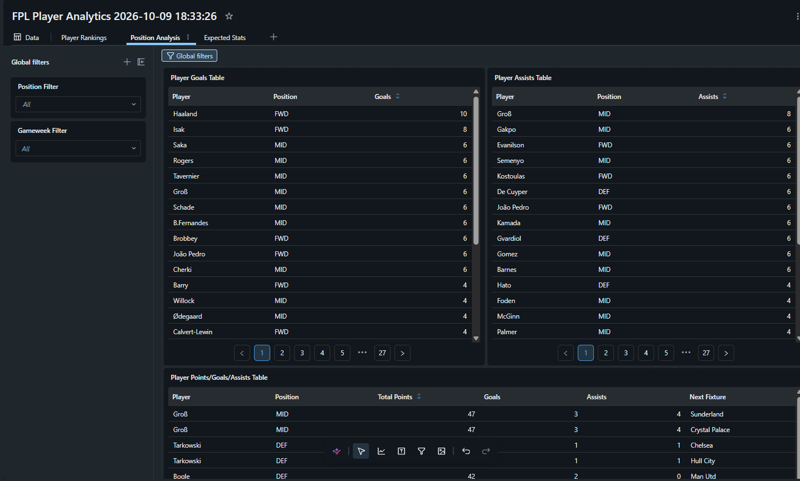

# FPL Project Kaushal

This project processes Fantasy Premier League (FPL) data to create a star schema for analytical purposes.

## Project Structure

- `1_setup/` - Initial setup and configuration
- `2_data_processing/` - Data cleaning and transformation scripts
- `3_fact_dim_table_creation/` - Fact and dimension table creation for star schema

## Diagram

## Setup Instructions

1. Clone the repository
2. Navigate to `1_setup/` and run the setup scripts
3. Process data in `2_data_processing/`
4. Generate star schema in `3_fact_dim_table_creation/`

## Technologies Used

- Python 
- SQL 
- Data processing libraries (Pandas, etc.)
- Pyspark
- Databricks

## Notes

This project was created as part of the FPL data analysis workflow.

## Dashboard sample: 
Sample of Databricks Dashboard

